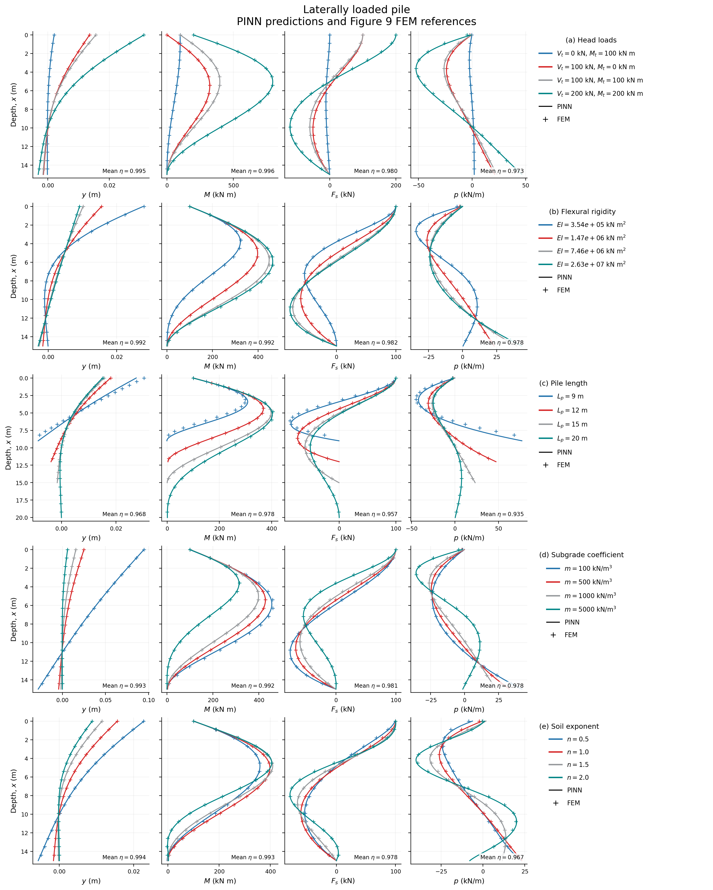

# PINN analysis of laterally loaded piles

**A single-notebook, physics-only implementation for laterally loaded piles.**

Based on Wu, Li, Liu, and Wan (2026), *Physics-Informed Neural Network Analysis of Laterally Loaded Piles Based on Elastic Subgrade Reaction Approach*, [doi:10.1002/nag.70382](https://doi.org/10.1002/nag.70382).

The notebook includes two independent reference-response networks, physics-only training, dimensional response recovery, and publication-style figures. All text and plot labels are in English.



## Quick start

Use Python 3.10-3.12. From this directory:

```bash
python -m venv .venv
# Windows PowerShell:
.venv\Scripts\Activate.ps1
# Linux/macOS:
# source .venv/bin/activate
python -m pip install -r requirements.txt
python -m ipykernel install --user --name pinn-pile --display-name "Python (PINN pile)"
jupyter lab laterally_loaded_piles.ipynb
```

Select **Python (PINN pile)**. To generate the figures with the bundled model, set `RUN_MODE = "pretrained"` in the first code cell and select **Run All**. The notebook selects `"pretrained"` by default; set `"train"` for a full training run. CPU inference is sufficient; no GPU, source PDF, parent directory, private helper module, or FEM package is required.

The displayed figures and tables were generated with the bundled pretrained model. Running the notebook again replaces the generated files in `figures/` and `results/`.

## What is reproduced

| Output | Content |
|---|---|
| Figure 4(b) study | Absolute and epoch-1000-relative losses for uniform units only; first 200,000 epochs of the available history |
| Figure 9 | Five parameter sweeps, four physical responses, all 20 published cases; PINN lines and extracted FEM markers |
| Metrics | Recomputed signed area overlap and relative L2 error on the digitized-marker intervals |

FEM values are read from [`data/figure9_fem_reference.csv`](data/figure9_fem_reference.csv). They are extracted vector-marker coordinates from the paper, **not original full-precision FEM output or newly computed solutions**. The notebook contains no FEM solver and never fits these values. See [`data/README.md`](data/README.md) for schema, calibration, precision, and a source discrepancy in the case labeled `Lp = 9 m`.

The available archive has 656,000 loss entries. Figure 4 uses the first 200,000, with each loss divided by its own actual value at epoch 1000 in the relative panel. The archive is not certified as the exact training realization printed in the paper. The final archived model is also not represented as a 200,000-epoch checkpoint.

## Training

Change `RUN_MODE` in the first code cell:

| Mode | Behavior |
|---|---|
| `pretrained` | Load the bundled model and history; generate the figures |
| `train` | Initialize both networks from scratch and train using physics only |
| `smoke` | Exercise three training epochs, verify finite gradients, then plot the archived model |

`TrainingConfig` exposes the seed, epoch count, collocation count, resampling interval, learning rate, and device. Defaults follow the paper: two separate networks with four 60-neuron hidden layers, Tanhshrink/Tanh/Tanh/Tanhshrink, reference normalized loads of 0.001 m, Adam at `1e-4`, 5000 collocation points, resampling every 100 epochs, and 200,000 epochs. GPU training is recommended for a full run. A three-epoch smoke run verifies execution; it is not a converged model.

Fresh models and history are saved under `results/`. They do not replace the bundled archive. Original optimizer state and original random seed were unavailable, so exact continuation of the archived training is not offered. Fresh runs record their configuration; bitwise agreement across different devices is not guaranteed.

## Mathematical scope

The pile satisfies

```text
k(x) = m x^n
EI y''''(x) + m x^n y(x) = 0
EI y''(0) = Mt       EI y'''(0) = Vt
EI y''(Lp) = 0       EI y'''(Lp) = 0
```

Depth is positive downward. Outputs follow the paper: `theta = y'`, `M = EI y''`, `Fs = EI y'''`, and `p = EI y'''' = -m x^n y`. The fourth-derivative value of `p` is plotted; the Winkler expression is evaluated separately to measure the governing residual.

The normalization uses `alpha = (m/EI) ** (1/(4+n))`, `xN = alpha*x`, and `LpN = alpha*Lp`. Two independent networks predict the moment-only and shear-only reference displacements, which are combined by linear elastic superposition. Differentiation is with respect to `xN`; dimensional recovery explicitly includes `alpha**j`.

All five physics residuals have units m, and their squared losses have units m². No additional data loss or hidden weighting is introduced.

The supported domain is `1.5 <= LpN <= 5`, `0.5 <= n <= 2`, and `0 <= xN <= LpN`. Inputs outside it raise an error. The paper's optional infinite-length approximation for longer piles is not silently applied. All Figure 9 inputs are within the domain.

The formulation assumes linear elasticity, small deflections, homogeneous pile rigidity, and independent Winkler springs. Some published parameter sweeps exceed the 0.01 m displacement scale discussed in the paper; their inclusion reproduces a comparison of linear models and does not validate large-deflection behavior.

## Repository layout

```text
laterally_loaded_piles.ipynb   All modeling, training, evaluation, and plotting
data/
  README.md                      Data sources, schema, extraction, limitations
  figure9_cases.csv              The 20 published parameter combinations
  figure9_fem_reference.csv      1360 FEM marker values, with PDF coordinates
  figure9_calibration.json       Axis ticks, affine transforms, source PDF hash
  training_history.csv.gz        Full 656000-row archived five-term loss history
models/
  pinn_model.pt                 Plain PyTorch state dictionary
  manifest.json                  Architecture, source files, hashes, limitations
figures/                         English PNG and SVG outputs
results/                         Predictions and metrics; earlier runs may add files
.github/workflows/verify.yml     CPU notebook smoke execution
requirements.txt                 Runtime and notebook dependencies
CITATION.cff                     Software citation and preferred paper citation
LICENSE                          MIT code license
CONTRIBUTING.md                  Contribution and validation guidance
CHANGELOG.md                     Release notes
```

## Verification

The smoke mode executes three short CPU training epochs and checks the resulting gradients before generating both figures using the bundled model.

For a headless smoke run:

```bash
# Linux/macOS:
PINN_RUN_MODE=smoke jupyter nbconvert --to notebook --execute \
  --ExecutePreprocessor.timeout=300 \
  --output smoke_executed.ipynb --output-dir results \
  laterally_loaded_piles.ipynb
```

```powershell
# Windows PowerShell:
$env:PINN_RUN_MODE = "smoke"
jupyter nbconvert --to notebook --execute --ExecutePreprocessor.timeout=300 --output smoke_executed.ipynb --output-dir results laterally_loaded_piles.ipynb
Remove-Item Env:PINN_RUN_MODE
```

The included outputs were verified with Python 3.11.5, PyTorch 2.6.0, NumPy 1.24.4, pandas 2.3.3, and Matplotlib 3.7.2. Dependencies specify compatible ranges, not a cross-platform lock file.

## Citation and license

Please cite the paper above when using this method or its digitized reference values. Machine-readable citation information is in [`CITATION.cff`](CITATION.cff).

Code and repository documentation are distributed under the [MIT License](LICENSE). The source journal PDF is not included. The paper and its original artwork remain subject to the publisher's terms. Numerical reference facts are attributed to the paper; this repository does not assert ownership of the original publication.
